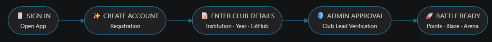
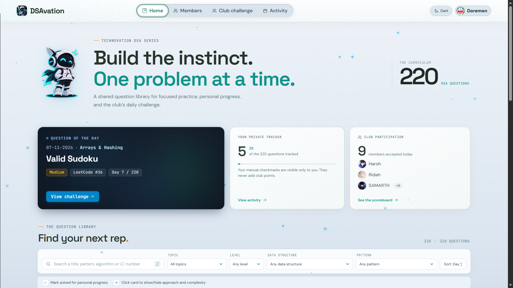
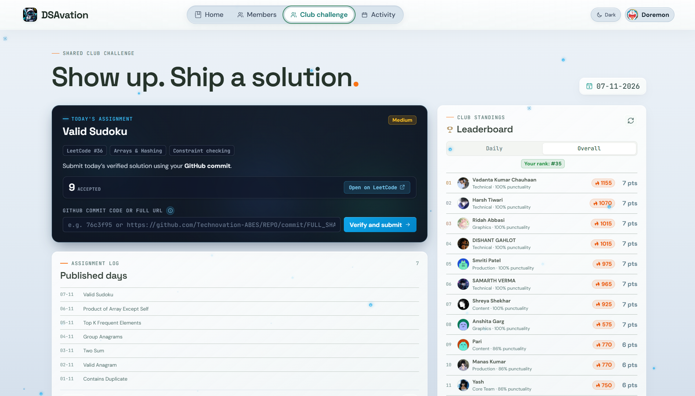
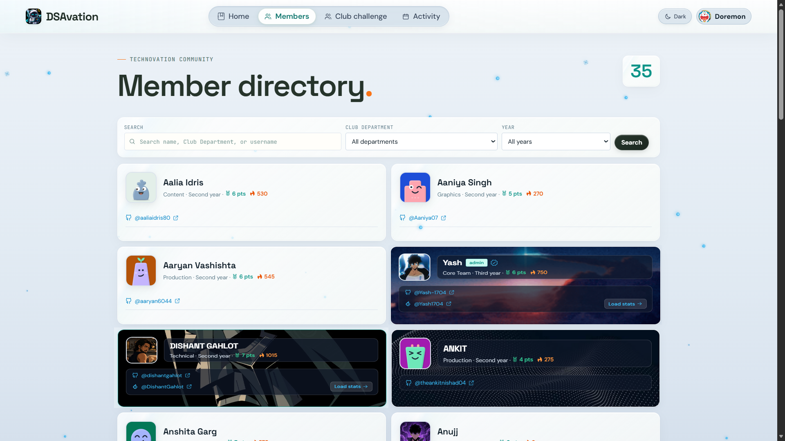
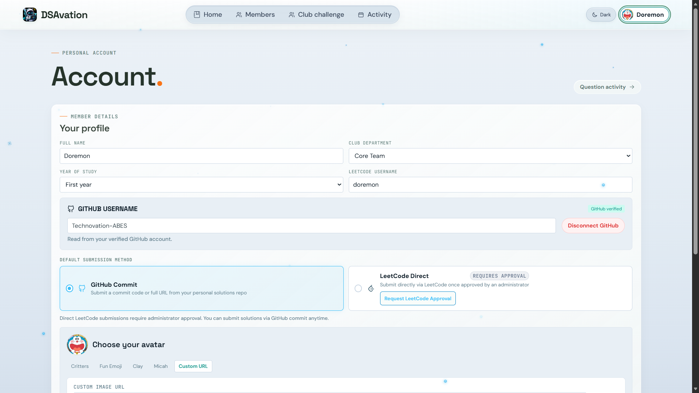
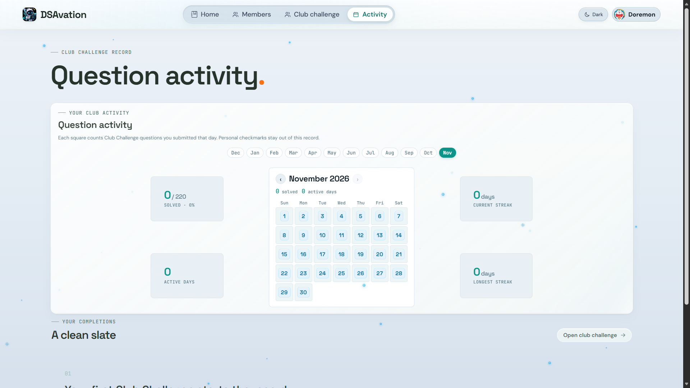
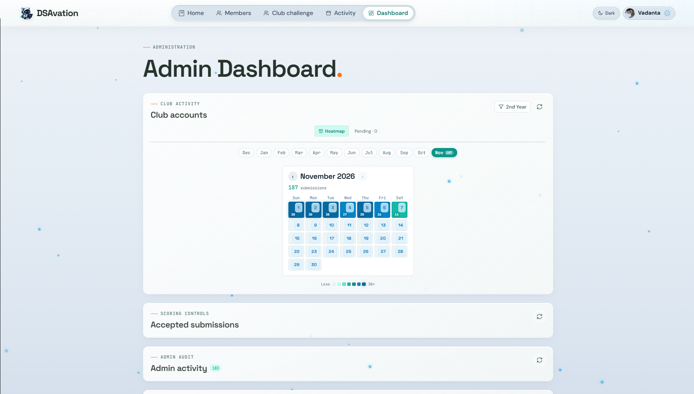
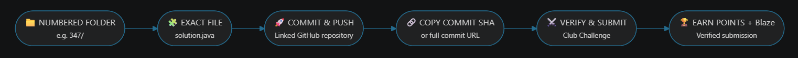
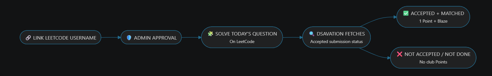

```text
  ██████╗  ███████╗  █████╗  ██╗   ██╗  █████╗ ████████╗ ██╗  ██████╗  ███╗   ██╗
  ██╔══██╗ ██╔════╝ ██╔══██╗ ██║   ██║ ██╔══██╗╚══██╔══╝ ██║ ██╔═══██╗ ████╗  ██║
  ██║  ██║ ███████╗ ███████║ ██║   ██║ ███████║   ██║    ██║ ██║   ██║ ██╔██╗ ██║
  ██║  ██║ ╚════██║ ██╔══██║ ╚██╗ ██╔╝ ██╔══██║   ██║    ██║ ██║   ██║ ██║╚██╗██║
  ██████╔╝ ███████║ ██║  ██║  ╚████╔╝  ██║  ██║   ██║    ██║ ╚██████╔╝ ██║ ╚████║
  ╚═════╝  ╚══════╝ ╚═╝  ╚═╝   ╚═══╝   ╚═╝  ╚═╝   ╚═╝    ╚═╝  ╚═════╝  ╚═╝  ╚═══╝
```

<p align="left"><em>by Technovation</em></p>

> **🔥 BUILD THE INSTINCT. CRUSH THE SHEET. CLIMB THE RANKS. 🔥**  
> *Daily LeetCode arena & 220-problem interview curriculum crafted for **Technovation — The Networking Club***

---

## 🧭 README NAVIGATION

> **⚡ Jump straight into the arena**

| 🚀 Start Here | 🧠 Explore the System |
| :--- | :--- |
| <a href="#-live-platform-access">🌐 Live Platform Access</a> | <a href="#-visual-platform-tour">🎮 Visual Platform Tour</a> |
| <a href="#-the-onboarding-pipeline">⚡ Onboarding Pipeline</a> | <a href="#-scoring-rules--blaze-mechanics">🏆 Scoring &amp; Blaze Mechanics</a> |
| <a href="#1️⃣--home-page--mission-control--private-library">🏠 Home — Mission Control</a> | <a href="#-github-commit-verification-protocol">📦 GitHub Verification</a> |
| <a href="#2️⃣--club-challenge--the-daily-battleground">⚔️ Club Challenge</a> | <a href="#-the-220-question-curriculum-blueprint">📚 220-Question Curriculum</a> |
| <a href="#3️⃣--member-directory--community--standings">👥 Member Directory</a> | <a href="#-architecture-overview">🏛️ Architecture Overview</a> |
| <a href="#-direct-leetcode-verification">🧠 Direct LeetCode Verification</a> | <a href="#6️⃣--admin-dashboard--moderation-console">🛠️ Admin Dashboard</a> |
| <a href="#4️⃣--profile--avatar-studio--identity--habit-tracker">👤 Profile &amp; Avatar Studio</a> | <a href="#5️⃣--question-activity--heatmap--submission-analytics">📊 Question Activity &amp; Heatmap</a> |

---

### 🌐 Live Platform Access

> 🚀 **24/7 LIVE ON VERCEL**
>
<h2 align="left">
 <a href="https://dsavation.vercel.app/" target="_blank" rel="noopener noreferrer"><kbd>🚀 &nbsp; OPEN DSAVATION ↗</kbd></a>
</h2>

```text
[ 🚀 Production Platform ]  ──▶  LIVE ON VERCEL
[ 🏛️ Tech Club ]            ──▶  Technovation: The Networking Club
[ 📚 Master Curriculum ]    ──▶  220 High-Yield Problems
[ ⚔️ Daily Challenge Arena ] ──▶  IST-Based Rolling Challenge Cycle
```

---

## ⚡ The Onboarding Pipeline



> **Club Verification Protocol:** To maintain platform authenticity and fair
> leaderboards, newly registered student accounts remain pending until verified
> by a Technovation club lead.

---

## 🎮 Visual Platform Tour

### 1️⃣ 🏠 Home Page — Mission Control & Private Library

The central command hub where every member tracks individual growth, checks off
solved problems, and launches today's assignment.

<picture>
  <source media="(prefers-color-scheme: dark)" srcset="docs/screenshots/home-dark.png">
  <source media="(prefers-color-scheme: light)" srcset="docs/screenshots/home-light.png">
  
</picture>

*💡 Question of the Day launcher, live club participation, and searchable
220-problem personal tracker.*

* 🔥 **Featured Daily Challenge Card:** Direct launcher into the active daily
  problem.
* 🔒 **Zero-Cheat Private Tracker:** Personal checkboxes stay private and never
  alter club leaderboard standings.
* 🔎 **Instant Multi-Filter:** Filter by **Topic**, **Data Structure**,
  **Interview Pattern**, or **Difficulty**.

---

### 2️⃣ ⚔️ Club Challenge — The Daily Battleground

Where Technovation members lock in, submit authentic commit links, and race
against the clock.

<picture>
  <source media="(prefers-color-scheme: dark)" srcset="docs/screenshots/club-challenge-dark.png">
  <source media="(prefers-color-scheme: light)" srcset="docs/screenshots/club-challenge-light.png">
  
</picture>

*💡 Problem details, commit hash verifier, and real-time daily sprint
leaderboard.*

* ⏱️ **IST-Based Challenge Cycle:** A rolling 24-hour competition window keeps
  the arena fair for the club.
* ⚡ **Speed Sprint Podium:** Earlier verified solutions earn stronger
  placements and bonus Blaze.
* 📜 **Challenge History Log:** Review past problem solutions and club
  statistics.

---

### 3️⃣ 👥 Member Directory — Community & Standings

A transparent club directory showcasing verified coders, their active branch,
and earned Blaze.

<picture>
  <source media="(prefers-color-scheme: dark)" srcset="docs/screenshots/member-directory-dark.png">
  <source media="(prefers-color-scheme: light)" srcset="docs/screenshots/member-directory-light.png">
  
</picture>

*💡 Member profile cards with department badges, Points, Blaze rating, and
GitHub links.*

* 🔍 **Multi-Dimensional Search:** Discover peers by **Branch/Department**,
  **Graduation Year**, or **Name**.
* 🌐 **Verified Credentials:** Jump directly to member GitHub profiles and
  verified contest identities.

---

### 4️⃣ 👤 Profile & Avatar Studio — Identity & Habit Tracker

Your personal coding identity, avatar customizer, and consistency dashboard.

<picture>
  <source media="(prefers-color-scheme: dark)" srcset="docs/screenshots/profile-dark.png">
  <source media="(prefers-color-scheme: light)" srcset="docs/screenshots/profile-light.png">
  
</picture>

*💡 Avatar presets, habit streaks, GitHub verification status, and recent
solutions.*

* 🎨 **Avatar Studio:** Switch between custom art themes — *Critters, Emoji,
  Clay, Micah* — or roll for a random avatar.
* 🛡️ **Account Credentials:** Manage your verified GitHub linkage and
  LeetCode submission verification permissions.

---

### 5️⃣ 📊 Question Activity — Heatmap & Submission Analytics

Comprehensive consistency radar featuring the interactive submission calendar, dynamic monthly record export, and daily verification metrics.

<picture>
  <source media="(prefers-color-scheme: dark)" srcset="docs/screenshots/activity-dark.png">
  <source media="(prefers-color-scheme: light)" srcset="docs/screenshots/activity-profile.png">
  
</picture>

*💡 Submissions heatmap, active streak diagnostics, verified commit links, and monthly CSV exports.*

* 🗓️ **Interactive Calendar Grid:** Click any active day to drill into the exact members who solved the problem and view verified commit proofs.
* 📥 **One-Click Monthly CSV Export:** Hover over any month tab to generate clean, color-coded submission attendance records.
* 📈 **Verified Club Progress:** Track acceptance rates, active days, and streak consistency across the entire club curriculum.

---

### 6️⃣ 🛠️ Admin Dashboard & Moderation Console

Centralized control room for club administrators to manage memberships, schedule daily challenges, audit submissions, and oversee club operations.

<picture>
  <source media="(prefers-color-scheme: dark)" srcset="docs/screenshots/admin-dark.png">
  <source media="(prefers-color-scheme: light)" srcset="docs/screenshots/admin-light.png">
  
</picture>

*💡 Member moderation, challenge scheduling, LeetCode permissions, Blaze adjustments, and rate-limit controls.*

* 👥 **Member Approvals & Roles:** Approve new registrations, manage admin access, and filter member rosters.
* 📅 **Challenge Management:** Schedule future assignments, publish daily problems, and assign or swap daily solution explainers.
* 🛡️ **Submission Auditing:** Review verified GitHub commit proofs and LeetCode submissions with live verification status and manual override tools.
* ⚡ **Aura & Rate Limits:** Award custom Blaze points, manage club honors, and monitor system rate limits in real time.

---

## 🏆 Scoring Rules & Blaze Mechanics

```text
                 ┌───────────────────────────────────────────────┐
                 │          OVERALL ── LEADERBOARD RANK          │
                 │           Points  ───▶  Blaze                │
                 └───────────────────────────────────────────────┘
                                  ▲            ▲
                                  │            │
            ┌─────────────────────┴──┐      ┌──┴─────────────────────────┐
            │   DAILY COMPLETION     │      │   SPEED SPRINT BONUS       │
            │   +1 Point / Problem   │      │   +50 / +40 / +30 Blaze    │
            └────────────────────────┘      └────────────────────────────┘
```

| Metric | Rule | Detail |
| :--- | :--- | :--- |
| ⏱️ **Daily Cycle** | **IST-based 24-hour window** | Only submissions inside the active cycle count for the daily leaderboard. |
| 🥇 **Daily Sprint** | **Timestamp Priority** | First verified submissions take the highest placements and earn bonus Blaze. |
| 👑 **Overall Rank** | **Points ➜ Blaze tie-breaker** | Ranked primarily by verified Points; Blaze decides ties. |
| 🛡️ **Integrity Safeguard** | **Strict Verification** | Only accepted GitHub or directly verified LeetCode submissions earn club Points. |

---

## 📦 GitHub Commit Verification Protocol

DSAvation validates code directly against your GitHub commits to build
authentic version-control habits. The verifier expects a precise repository
layout so every submission can be matched to the correct LeetCode problem.

### 📁 Repository Structure

Keep solutions in a personal repository with folders named only by the
numerical **LeetCode Problem ID**. Inside each folder, the file must be named
exactly `solution.<extension>` — not `solutions`, `sol`, or any other variant:

```text
my-dsa-solutions/
├── 1/
│   └── solution.cpp          # LeetCode #1: Two Sum
├── 49/
│   └── solution.py           # LeetCode #49: Group Anagrams
└── 347/
    └── solution.java         # LeetCode #347: Top K Frequent Elements
```

✅ **Accepted format:** `<leetcode-question-number>/solution.<extension>`  
❌ `1/solutions.cpp`, `1/sol.cpp`, `1/two-sum.cpp`, and similarly named files
will not pass the verifier.

Supported extensions: `.c`, `.cpp`, `.go`, `.java`, `.js`, `.py`, `.rs`, `.ts`,
and `.txt`.

### 🚀 Submission Flow



1. Create a folder named after the numerical LeetCode question number.
2. Save your code as exactly `solution.<extension>`.
3. Commit and push during the active challenge cycle.
4. Paste the **Commit SHA** or full **Commit URL** into Club Challenge.
5. Click **Verify and Submit** to enter the arena.

---

## 🧠 Direct LeetCode Verification

Prefer solving directly on LeetCode? DSAvation can fetch and verify your
submission from your linked LeetCode account.



### How it works

1. Add your LeetCode username to your DSAvation profile.
2. Request and receive administrator approval for **LeetCode Direct** mode.
3. Solve and submit the assigned question on LeetCode during today's IST
   challenge cycle.
4. DSAvation fetches your direct LeetCode submission and checks its status.
5. A matching **Accepted** submission earns the club Point and eligible Blaze.
   If the problem was not submitted or is not accepted, no club Point is
   awarded.

GitHub Commit verification remains available anytime, even when LeetCode Direct
approval is pending.

---

## 📚 The 220-Question Curriculum Blueprint

Curated from the intersection of **Striver's A2Z DSA Sheet** and **NeetCode's
problem roadmap**, structured from fundamental patterns to advanced topics:

| # | Topic | Key Interview Patterns & Techniques |
| :-: | :--- | :--- |
| **01** | 🧩 **Arrays & Hashing** | Hash sets, frequency counting, complement lookups, prefix/suffix products |
| **02** | 🎯 **Two Pointers** | Opposite-end convergence, three-pointer partitions, container boundaries |
| **03** | 🪟 **Sliding Window** | Dynamic frequency windows, fixed-size subarrays, character replacement |
| **04** | 🥞 **Stack & Queue** | Monotonic stacks, min-stacks, valid parentheses, window maximums |
| **05** | 🔍 **Binary Search** | Rotated arrays, condition functions, split-array search |
| **06** | 🔗 **Linked Lists** | Fast/slow pointers, in-place reversal, cycle detection, reorder list |
| **07** | 🌳 **Trees & BSTs** | Level-order BFS, LCA, subtree serialization, maximum path sum |
| **08** | 🌲 **Tries** | Prefix trees, word-search backtracking, autocomplete |
| **09** | 🏔️ **Heap & Priority Queue** | Top-K elements, k-way merges, scheduling, streaming medians |
| **10** | ♟️ **Backtracking** | Decision trees, pruning, subset generation, N-Queens |
| **11** | 🕸️ **Graphs & Advanced Graphs** | BFS/DFS, topological sort, Dijkstra, Prim/Kruskal, DSU |
| **12** | 📈 **1-D Dynamic Programming** | Fibonacci states, climbing stairs, house robber, coin change, LIS |
| **13** | 📊 **2-D Dynamic Programming** | Grid traversals, edit distance, LCS, 0/1 knapsack |
| **14** | 💰 **Greedy Algorithms** | Jump game, gas stations, interval scheduling, maximum subarray |
| **15** | ⏱️ **Intervals** | Merging overlaps, insert intervals, meeting rooms |
| **16** | 💻 **Bit Manipulation & Math** | Single-number XOR, bit counts, reverse integer, matrix rotations |

---

## 🏛️ Architecture Overview

```text
[ User Browser ]  <─── HTTPS ───>  [ Vercel / React Application ]
                                            │
                                            ▼
                               [ Node.js API Micro-Engine ]
                                            │
                      ┌─────────────────────┴─────────────────────┐
                      ▼                                           ▼
             [ MongoDB Atlas ]                          [ GitHub API ]
          (Profiles, Streaks, Days)                  (Commit Verification)
```

### 📁 Project Structure

```text
DSAvation/
├── api/                   # Vercel serverless function entry (handler.js)
├── client/                # Frontend application
│   ├── public/            # Static assets (favicons, manifests, mascots)
│   ├── src/               # React application source
│   │   ├── api/           # API fetch client
│   │   ├── components/    # Reusable UI & modal components
│   │   ├── data/          # Frontend constants
│   │   ├── hooks/         # Custom React hooks
│   │   ├── pages/         # Screen-level views
│   │   ├── routes/        # Route resolver & path mapping
│   │   └── utils/         # Helper functions & styling utilities
│   └── index.html         # Client HTML entry point
├── docs/                  # Architecture diagrams, screenshots, algorithm specs
│   ├── charts/            # Flowcharts & diagrams
│   ├── references/        # Historical specs & reference docs
│   └── screenshots/       # UI showcase screenshots
├── server/                # Backend services & data
│   ├── data/              # 220 DSA questions database
│   ├── api.js             # Core HTTP API engine & routes
│   ├── db.js              # MongoDB Atlas connection & schema indexes
│   └── email.js           # SMTP email dispatch & templates
└── test/                  # Automated test suite (40/40 passing)
```

---

<div align="center">

## 🏅 THE BUILD CREW

> **The minds behind the arena. The energy behind the climb.**

| # | Contributor | GitHub |
| :-: | :--- | :---: |
| **01** | **Yash Prajapati** **[Tech Lead]** | 🔗 <a href="https://github.com/Yash-1704" target="_blank" rel="noopener noreferrer">Yash-1704</a> |
| **02** | **Harsh Tiwari** | 🔗 <a href="https://github.com/harshtiwari47" target="_blank" rel="noopener noreferrer">harshtiwari47</a> |
| **03** | **Dishant Gahlot** | 🔗 <a href="https://github.com/dishantgahlot" target="_blank" rel="noopener noreferrer">dishantgahlot</a> |
| **04** | **Vadanta Kumar Chauhaan** | 🔗 <a href="https://github.com/vedisvigourous" target="_blank" rel="noopener noreferrer">VedisVigourous</a> |

</div>

---

<div align="center">

### Made with ❤️‍🔥 by the Technical team, Technovation

*Consistency • Competition • Code*

</div>
