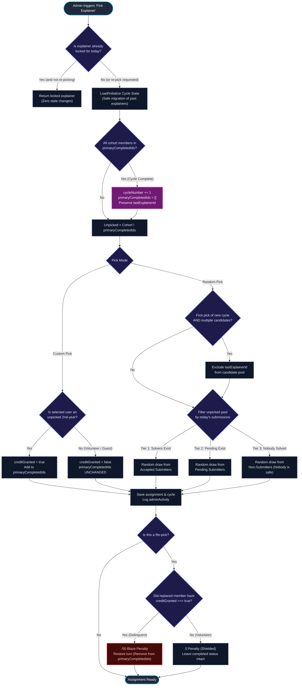

# DSAvation Solution Explainer Engine: Randomized Round Robin Specification

> **Version:** 3.0 (Production Verified)  
> **Algorithm:** Randomized Round Robin (Dynamic Sampling Without Replacement)  
> **Target Cohort:** Approved 2nd-Year Club Members (~30 students)  
> **State Persistence:** MongoDB (`explainerCycle` collection)  
> **Status:** Fully Implemented & Tested (40/40 tests passing)

---

## 1. Core Principle & Objective

The **Solution Explainer Engine** coordinates daily evening solution walkthroughs for the DSAvation Club Challenge.

### Core Motive: 100% Equal Opportunity
Every approved second-year member receives **exactly one turn** to present before anyone repeats.

1. **Random Daily Selection**: Randomly draws an unselected member from the active cohort.
2. **Merit-Driven Submission Priority**:
   * **Tier 1**: Members with `accepted` submissions for today's problem.
   * **Tier 2**: Members with pending/rejected submissions.
   * **Tier 3**: Members who have not submitted ("Nobody is safe").
3. **Safe Past-Explainer Migration**: Any members previously selected as explainers prior to this engine are automatically recognized in `primaryCompletedIds` so they are **not repeated** in Cycle 1.
4. **Volunteer & Guest Shield**: Re-picking an emergency volunteer or outside mentor does **not** penalize them with 50 Blaze, and does **not** erase their past completed turn.
5. **Multi-Admin Activity Synchronization**: Every draw, custom select, re-pick, and penalty is attributed to the specific admin in the `adminActivity` audit log and visible in real-time.
6. **Cycle Boundary Protection**: The final explainer of Cycle $K$ is shielded from being drawn on Day 1 of Cycle $K+1$.

---

## 2. Database Schema

### Collection: `explainerCycle` (`_id: "current"`)
```json
{
  "_id": "current",
  "cycleNumber": 1,
  "primaryCompletedIds": [
    "672a1001cc399c449fdaa001",
    "672a1002cc399c449fdaa002"
  ],
  "lastExplainerId": "672a1002cc399c449fdaa002",
  "updatedAt": "2026-11-07T14:00:00.000Z"
}
```

### Assignment Explainer Fields (`assignments` collection)
```json
{
  "_id": "672b1000...",
  "dateKey": "2026-11-07",
  "questionId": 217,
  "explainerUserId": "672a1002cc399c449fdaa002",
  "explainer": {
    "id": "672a1002cc399c449fdaa002",
    "userId": "672a1002cc399c449fdaa002",
    "name": "Student Two",
    "studyYear": "second-year",
    "department": "Computer Science",
    "status": "accepted",
    "pickedAt": "2026-11-07T14:00:00.000Z"
  },
  "cycleNumber": 1,
  "explainerCycleCreditGranted": true,
  "isRepicked": false,
  "repickCount": 0
}
```

---

## 3. Decision Logic & Flow



---

## 4. Multi-Admin Audit Activity

All actions are logged to `adminActivity` with the actor's identity:

```json
{
  "actorId": "653a1001...",
  "actorName": "Harsh Tiwari",
  "actorRole": "admin",
  "action": "explainer_selected",
  "targetId": "672b1000...",
  "targetLabel": "2026-11-07 · LC 217",
  "details": {
    "explainerUserId": "672a1002...",
    "explainerName": "Student Two",
    "studyYear": "second-year",
    "isCustom": false,
    "creditGranted": true,
    "cycleNumber": 1,
    "completedInCycle": 15,
    "totalCohort": 30
  },
  "createdAt": "2026-11-07T14:00:00.000Z"
}
```

---

## 5. Summary of Enhancements

1. **Safe Past Explainer Persistence**: If `explainerCycle` has not been initialized, it scans all past assignments and pre-populates `primaryCompletedIds` so previously selected explainers are not repeated.
2. **Volunteer Shield**: Volunteers who already completed their turn and step in via Custom Re-pick receive `explainerCycleCreditGranted: false` and are immune from the -50 Blaze penalty if replaced.
3. **Admin Penalty Waiver**: Admins can optionally check a waiver box (`waivePenalty: true`) during custom re-picks to forgive honest mis-clicks or mutual swaps.
4. **Unlimited Re-picks**: Admins are never locked to 1 re-pick per day.
5. **Cycle Boundary Protection**: Prevents back-to-back selections on Day 1 of Cycle $K+1$.
