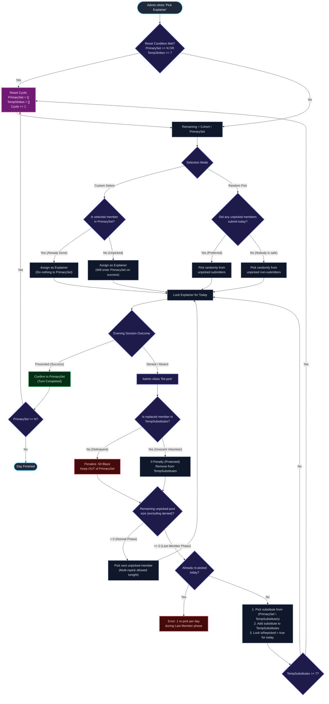
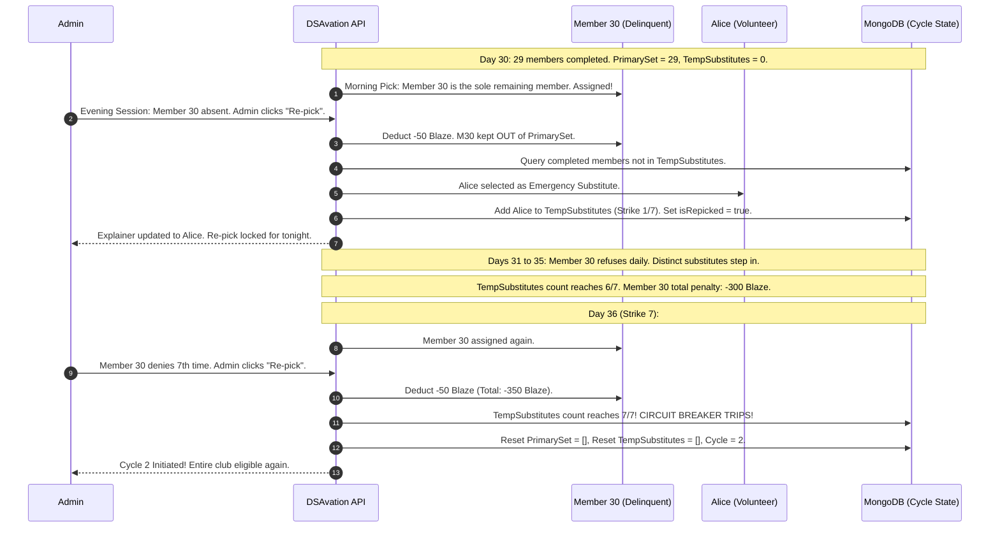

# DSAvation Solution Explainer Engine: Architecture & Algorithm Specification

> **Version:** 2.0  
> **Target Cohort:** Approved 2nd-Year Club Members (~30 students)  
> **Status:** Production Specification  

---

## 1. Executive Summary & Purpose

In DSAvation, every Question of the Day concludes with an **Evening Solution Breakdown** where a member presents their code walkthrough, algorithmic intuition, and time/space complexity analysis to the club.

The **Solution Explainer Engine** is an automated, fair, and cheat-proof selection system designed to satisfy four core principles:
1. **Zero Repetition in a Cycle**: Every 2nd-year member must be selected and complete their turn before any member is repeated.
2. **Accountability ("Nobody is Safe")**: Members who solved today's problem are prioritized, but non-submitters in the remaining pool are fully eligible. Inactive members cannot hide from being chosen.
3. **Innocence Shield for Volunteers**: When an emergency substitute steps in for a member who refused, that substitute is immune from penalties if they are later replaced.
4. **Circuit Breaker on Deadlock**: If the final unpicked student repeatedly refuses to present, the system permits up to 7 distinct substitute days before automatically resetting the cycle, preventing the club from stalling indefinitely.

---

## 2. Mathematical Formalism & State Machine

### 2.1 Definitions & Cohort
Let $\mathcal{C}$ be the dynamic set of all approved 2nd-year club members:
$$\mathcal{C} = \{ u \in \text{Users} \mid \text{approvalStatus}(u) = \text{"approved"} \land \text{studyYear}(u) = \text{"second-year"} \}$$
$$N = |\mathcal{C}| \quad (\text{Dynamic count, nominally } N \approx 30)$$

### 2.2 System State Tuple
The engine state is represented by the persistent tuple $\mathcal{S} = (\mathcal{P}, \mathcal{T}, \kappa, \ell)$:
* $\mathcal{P} \subseteq \mathcal{C}$: **Primary Set** — The set of distinct member IDs who have completed their scheduled turn in the current cycle.
* $\mathcal{T} = [ (t_1, u_1^{\text{sub}}, u_1^{\text{orig}}), \dots ]$: **Temporary Substitute Roster** — An ordered record of emergency repeat substitutions triggered by a delinquent member, bounded by threshold $K_{\max} = 7$.
* $\kappa \in \mathbb{N}^+$: Current cycle number ($\kappa = 1, 2, 3, \dots$).
* $\ell \in \mathcal{C} \cup \{ \text{null} \}$: The last confirmed explainer of cycle $\kappa - 1$, used to prevent back-to-back selections on Day 1 of cycle $\kappa$.

### 2.3 State Invariants

#### Invariant 1 (Strict Zero-Repetition)
$$\forall u \in \mathcal{P}, \quad \mathbb{P}(\text{DailyPick}(u)) = 0$$
No member already in $\mathcal{P}$ can be selected in the morning daily pick.

#### Invariant 2 (Cycle Reset Condition)
$$\text{ResetCondition}(\mathcal{S}) \iff |\mathcal{P}| \ge N \;\lor\; |\mathcal{T}| \ge 7$$
When this condition evaluates to true, both sets wipe clean:
$$\mathcal{P} \leftarrow \emptyset, \quad \mathcal{T} \leftarrow [], \quad \kappa \leftarrow \kappa + 1, \quad \ell \leftarrow \text{lastExplainerId}$$

#### Invariant 3 (Substitute Fairness)
$$\forall u \in \text{Substitutes}(\mathcal{T}), \quad \mathbb{P}(\text{EmergencyDraft}(u)) = 0 \quad (\text{while } |\mathcal{P} \setminus \mathcal{T}| > 0)$$
No completed volunteer is forced to substitute twice within the same 7-strike window.

---

## 3. Core Mechanics & Decision Logic



---

### 3.1 Daily Morning Pick Logic
1. **Target Pool**:
   $$\text{Remaining} = \mathcal{C} \setminus \mathcal{P}$$
2. **Prioritization Cascade**:
   * **Tier 1 (Unpicked Submitters)**: Members in $\text{Remaining}$ who submitted today's problem with status $\ne \text{"invalidated"}$. (Accepted submissions prioritized over pending).
   * **Tier 2 (Unpicked Non-Submitters)**: If no unpicked member submitted, the system draws randomly from $\text{Remaining}$. Non-submitters are **not safe**; everyone must be ready to explain.
3. **Locking**:
   The selected member is assigned to `assignment.explainer`. Repeated calls simply return this locked card.

---

### 3.2 Phase-Aware Re-Pick Engine

The behavior of the **Re-pick** action adapts depending on the cycle phase:

| Dimension | Normal Phase (Day 1 to $N-1$) | Final-Member Phase (Day $N$, only 30th member left) |
| :--- | :--- | :--- |
| **Available Unpicked Pool** | $\ge 1$ unpicked members exist | $0$ unpicked members left |
| **Daily Re-pick Limit** | **Unlimited**: Admin can re-pick through unpicked members if mic/attendance fails. | **Strictly 1 Re-pick Per Day**: Prevents burning substitute strikes in a single evening. |
| **Substitute Target** | Draws next candidate from $\text{Remaining}$. | Draws repeat volunteer from $\mathcal{P} \setminus \mathcal{T}$. |
| **Circuit Breaker Impact** | **0 strikes added**: Does not touch $\mathcal{T}$. | **+1 strike added**: Logs to $\mathcal{T}$ ($1/7, 2/7, \dots, 7/7$). |

---

### 3.3 The Innocence Shield (Volunteer Protection)

When Re-pick is triggered against user $u_{\text{replaced}}$:
```javascript
const isVolunteer = state.tempSubstitutes.some(s => String(s.userId) === String(u_replaced));

if (!isVolunteer) {
  // Original delinquent member -> Penalize -50 Blaze
  await deductBlaze(u_replaced, -50);
  state.primaryCompletedIds.remove(u_replaced); // Target them again tomorrow
} else {
  // Innocent volunteer stepping down -> ZERO penalty
  // Volunteer is removed from tonight's assignment without punishment
}
```

---

### 3.4 Custom Select Idempotency
Admins can manually pick any member from the directory at any time:
* **If member $\notin \mathcal{P}$**: Assigned as today's explainer and will enter $\mathcal{P}$ upon completion.
* **If member $\in \mathcal{P}$ (Already Completed)**: The system assigns them for tonight's session but **does nothing to $\mathcal{P}$** (no duplicate records, no cycle corruption).

---

## 4. Sequence Diagram: The 30th Member Deadlock

This sequence illustrates what occurs when the 30th member repeatedly denies and how the circuit breaker trips on the 7th strike:



---

## 5. Database Schemas

### 5.1 Collection: `explainerCycle` (`_id: "current"`)
```json
{
  "_id": "current",
  "cycleNumber": 1,
  "primaryCompletedIds": [
    "672a1001...",
    "672a1002..."
  ],
  "tempSubstitutes": [
    {
      "dateKey": "2026-11-07",
      "userId": "672a1005...",
      "originalUserId": "672a1030...",
      "timestamp": "2026-11-07T15:30:00.000Z"
    }
  ],
  "lastExplainerId": "672a1005...",
  "updatedAt": "2026-11-07T15:30:00.000Z"
}
```

### 5.2 Document: `assignments` (Fields Relevant to Explainer)
```json
{
  "_id": "672c...",
  "dateKey": "2026-11-07",
  "questionId": 217,
  "explainerUserId": "672a1005...",
  "explainer": {
    "userId": "672a1005...",
    "name": "Alice Sharma",
    "department": "CSE",
    "studyYear": "second-year",
    "status": "accepted",
    "isVolunteerSubstitute": true,
    "pickedAt": "2026-11-07T15:30:00.000Z"
  },
  "isRepicked": true,
  "repickCount": 1
}
```

---

## 6. API Endpoint Contracts

### `POST /api/admin/pick-explainer`
* **Headers**: Admin/Lead Cookie.
* **Payload**:
  * `{}`: Morning automatic pick or idempotent view.
  * `{ repick: true }`: Re-pick today's explainer.
  * `{ userId: "672..." }`: Custom select override.
* **Success Response (`200 OK`)**:
  ```json
  {
    "explainer": {
      "userId": "672a1005...",
      "name": "Alice Sharma",
      "department": "CSE",
      "studyYear": "second-year",
      "status": "accepted"
    },
    "isNew": true,
    "isRepick": true,
    "cycle": {
      "cycleNumber": 1,
      "completedCount": 29,
      "totalCohort": 30,
      "tempStrikes": 1,
      "maxStrikes": 7
    }
  }
  ```
* **Error Response (`400 Bad Request`)**:
  ```json
  {
    "error": "Re-pick can only be performed once per day during the final member phase."
  }
  ```

### `GET /api/admin/explainer-candidates`
* **Response**:
  ```json
  {
    "cycle": {
      "cycleNumber": 1,
      "completedCount": 29,
      "totalCohort": 30,
      "tempStrikes": 1,
      "maxStrikes": 7
    },
    "isRepickedToday": true,
    "candidates": [
      {
        "id": "672a1005...",
        "name": "Alice Sharma",
        "studyYear": "second-year",
        "turnCompleted": true,
        "isCurrentExplainer": true,
        "submittedToday": true
      }
    ]
  }
  ```

### `DELETE /api/admin/pick-explainer`
* **Action**: Clears today's explainer from assignment. Rolls back today's member from `primaryCompletedIds` or `tempSubstitutes`. Resets `isRepicked = false`.

---

## 7. Edge Case Playbook

| Edge Case | Root Trigger | Resolution in Engine |
| :--- | :--- | :--- |
| **New member joins or drops out** | Cohort count changes mid-cycle | Dynamic $N = |\text{approved 2nd years}|$. Reset condition checks $\ge N$ dynamically. |
| **Session runs past Midnight IST** | Clock rolls to next calendar date | Endpoints accept and lock to the active `assignmentId`, immune to server wall-clock drift. |
| **Volunteer cannot present** | Emergency volunteer declines | Re-pick identifies volunteer in `tempSubstitutes` $\rightarrow$ $0$ penalty applied. Next substitute drafted. |
| **Ghost student never logs in** | Inactive account in DB | Admins delete account via Admin panel $\rightarrow$ dynamically removed from cohort. |
| **Admins delete today's assignment** | Question published in error | `deleteAssignment` rolls back today's explainer entry from the cycle state automatically. |

---

*Authored for DSAvation Core Engineering Team.*
